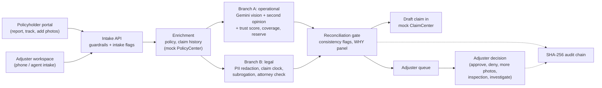

# AI-Powered Human-Governed FNOL Claims Intelligence Engine

[](https://github.com/Vsd1208/Autonomous-Parallel-Multi-Agent-FNOL-Claims-Compliance-Engine/actions/workflows/ci.yml)
[](LICENSE)

**Problem.** When a policyholder reports a loss (First Notice of Loss, FNOL), an adjuster has to check coverage, judge
the damage from photos, set a reserve, meet state claim-handling deadlines and look for fraud and recovery chances,
mostly by hand and under time pressure.

**Solution.** This engine takes the FNOL, then runs an operational branch (photo damage assessment with Google Gemini,
checked by a second model trained here; coverage; reserve) and a legal branch (PII redaction, a cited state claim clock,
subrogation) in parallel under one deadline. A reconciliation gate cross-checks the two, explains its recommendation in
a six-factor WHY panel and files a draft claim in (mock) Guidewire ClaimCenter. A licensed adjuster makes every
decision, and every step is written to a tamper-evident audit chain.



### What is real and what is simulated

| Component | Real or simulated | Why | Where in code |
|---|---|---|---|
| Damage assessment | **Real** Gemini 2.5 Flash API calls when a key is set; a deterministic mock for demos and tests | Demos and CI must run without a key | `GeminiVisionProvider.java`, `MockVisionProvider.java` (`fnol-agents`) |
| Second-opinion vision model | **Real**, trained in this project on 441 public-domain photos | An independent check on a third-party model | `fnol-vision-ml/`, `tools/second-opinion/` |
| Trust score (calibrated confidence) | **Real**, fitted and measured on 50 labelled Gemini answers | Gemini's own confidence does not separate right from wrong | `TrustScorer.java`, `tools/vision-eval/trust_score.py` |
| Face and licence-plate blurring | **Real** (OpenCV, YuNet) | Photos leave for an external model | `fnol-vision-ml/redaction/` |
| PII redaction in text | **Real**, rule-based | Personal data must not reach models or logs | `PiiRedactionAgent.java`, `PIIGuardrail.java` |
| State claim clock (CA, NY, TX, FL, IL) | **Real citations**; a prototype not reviewed by a lawyer; 3 recovery limits unverified | Deadlines are what regulators examine | `claim-regulations.json`, `CitedDeadlineRuleProvider.java`, [docs/legal-compliance.md](docs/legal-compliance.md) |
| Coverage rules, subrogation weights | **Simulated** (synthetic prototype values) | No insurer's real rules are available | `SyntheticCoverageRuleProvider.java`, `DeterministicSubrogationScorer.java` |
| PolicyCenter and ClaimCenter | **Simulated**: a mock service over HTTP, modelled on but not verified against Guidewire's Cloud API | Students have no Guidewire Cloud tenant | `fnol-mock-guidewire/`, [docs/guidewire-integration.md](docs/guidewire-integration.md) |
| Policies, claimants, claim history | **Simulated** seed data | No real customer data | `fnol-mock-guidewire/` |
| Claim photos | **Real** public-domain photos (NHTSA crash tests, FEMA, CC0) | Realistic input without privacy issues | `demo-scenarios/sample-images/`, [CREDITS.md](CREDITS.md) |
| Fraud signals | **Real** rules (duplicates, reused photos, claim frequency, early-policy losses, amount above estimate) applied to simulated data | Common fraud patterns an adjuster checks | `IntakeReviewService.java`, `GateConsistencyChecker.java`, `EvidenceStore.java` |
| Fraud anomaly score | **Real** explainable scorer; **simulated** calibration (fitted on synthetic claims, accuracy on real claims unknown) | No labelled fraud data is public | `FraudAnomalyScorer.java`, `tools/fraud-eval/` |
| Adjuster authentication | **Simulated**: one shared token | Prototype; real identity is out of scope | `AdjusterTokenFilter.java` |
| Orchestration, persistence, audit chain | **Real** (Spring Boot, PostgreSQL, Flyway) | The production-shaped part of the system | `FNOLOrchestrator.java`, `AuditService.java` |

### Key results

All from small public datasets, not real claims. Every number, with its run, date, sample and caveat, is in
[docs/metrics.md](docs/metrics.md).

| Result | Value | Source |
|---|---|---|
| Wrong Gemini answers that could go straight through: confidence check only → all vision checks | **9 → 1** of 50 | [metrics §3](docs/metrics.md#3-vision-checks-replayed-gate-ablation-vehicle) |
| Separation of right from wrong answers (AUC): trust score vs Gemini's own confidence | **0.68** vs 0.52 (50 photos) | [metrics §2](docs/metrics.md#2-trust-score-calibrated-ai-confidence-vehicle-claims) |
| Gemini damaged area right, lenient / strict | 82% / 56% (50 photos); dollar estimates not validated | [metrics §1](docs/metrics.md#1-gemini-damage-assessment-vehicle) |
| Wrong answers passing every other check that the second opinion caught | 2 of 2 (56 answers) | [metrics §4](docs/metrics.md#4-second-opinion-model-trained-in-this-project) |
| Backend tests, build warnings | 253 passing, 0 warnings | [metrics §6](docs/metrics.md#6-engineering) |

### Quick start (no API key needed)

Needs Docker and bash. The first build downloads the second-opinion model's image encoder (about 1 GB).

```bash
git clone https://github.com/Vsd1208/Autonomous-Parallel-Multi-Agent-FNOL-Claims-Compliance-Engine.git && cd Autonomous-Parallel-Multi-Agent-FNOL-Claims-Compliance-Engine
docker compose --env-file .env.demo up -d --build
bash demo-scenarios/run-all.sh
```

Then open the adjuster workspace at http://localhost:5173 and the policyholder portal at http://localhost:5174.
More: [running locally](#running-locally), [the insurance terms explained](docs/DOMAIN.md), [roadmap and known
limits](docs/ROADMAP.md).

---

## Governance statement

**By default every claim gets a human decision.** With `fnol.stp.require-advisory-review=true` (env `FNOL_STP_REQUIRE_ADVISORY_REVIEW`, the default) a claim that meets every straight-through-processing (STP) rule is pre-filed in ClaimCenter but saved as `PENDING_ADVISORY_REVIEW`; it counts as filed only after an adjuster confirms it. Setting the flag to `false` lets STP-eligible claims be filed as `STRAIGHT_THROUGH_PROCESSING` with no human step — a business decision (see [ADR-009](docs/architecture-decisions.md)).

- AI analyzes, recommends and explains; it never pays.
- Any failed factor, HIGH severity or intake flag routes the claim to `HUMAN_REVIEW`.
- Every failed intake (blocked, uncovered, timed out or any processing error) is saved as a `REJ-…` claim and queued for a human instead of being dropped. Duplicate submissions flag the original claim for verification.
- ClaimCenter claims stay drafts (`DRAFT_PENDING_REVIEW`) until a human decides.
- Every agent step, failure and adjuster decision is recorded in a SHA-256 hash-chained audit trail. Raw PII is never stored or hashed.
- Coverage rules and subrogation weights are **synthetic prototype values**. The state claim clock cites real regulations ([docs/legal-compliance.md](docs/legal-compliance.md)) but has not been reviewed by a lawyer; Compliance must confirm all rules before production use.

## End-to-end flow

```text
0. Policyholder portal       report a loss (WEB), track it, add requested photos (separate app, no adjuster access)
1. FNOL intake               claim, policy, claimant, evidence URIs, channel
2. Input validation (HRP1)   format guardrail + intake review flags
3. Context enrichment        policy, claim history, frequency risk
4. Dual-branch analysis      Branch A: damage, coverage, reserve + confidence | Branch B: PII, deadlines, liability
5. Reconciliation gate       subrogation, guardrails, consistency checks, WHY panel, ClaimCenter draft, audit
6. Routing                   PENDING_ADVISORY_REVIEW | STRAIGHT_THROUGH_PROCESSING | HUMAN_REVIEW
7. Human review (HRP2/HRP3)  adjuster queue, modify findings, decision, ClaimCenter update + tracked action, audit
```

See [docs/architecture.md](docs/architecture.md) for the full diagram, and [docs/diagram-traceability.md](docs/diagram-traceability.md) for how each of the 23 diagram components maps to code, endpoints and tests.

## Implementation status

| Area | Status |
|---|---|
| FNOL intake API with channel, optional claimant phone/email | Done |
| Input guardrail + intake review flags (Human Review Point 1) | Done |
| Claim-history enrichment (frequency risk) | Done |
| Parallel branches on a bounded executor, one deadline, interrupting cancel | Done |
| Vision: Gemini provider with SSRF-safe evidence loading; deterministic mock provider | Done |
| Coverage by line of business (AUTO, HOME) | Done (synthetic rules) |
| Recommended reserve (amount owed): min(amount claimed, AI estimate) − deductible, capped at the limit (BigDecimal), with confidence score | Done |
| Claims above the AI estimate never auto-approved: adjuster can request more photos, assign an inspector, investigate or approve at the AI estimate | Done |
| Standard photo set: front, rear, left, right and a damage close-up (home: overview and close-up), all sent to the AI together; an incomplete set is flagged `INCOMPLETE_PHOTO_SET` | Done |
| Adjuster sets the final reserve (pre-filled with the AI or inspected recommendation; a different amount needs a reason) | Done |
| Supplementary photos: adjuster sends a one-time, 7-day upload link; the claimant adds the requested views to the same claim, which returns to the adjuster | Done |
| Damage inspection: adjuster assigns an inspector (field, desk or body shop); the report gives the accident-related cost, earlier damage excluded | Done |
| PII redaction (SSN, DOB, MRN, name, phone, email) + PII guardrail | Done |
| State claim clock: acknowledge-by and decide-by from cited regulations (CA, NY, TX, FL, IL), urgency flag, acknowledgement letter | Done (prototype, not legally reviewed) |
| Subrogation: Branch B liability assessment with compliance notes, finalised with Branch A's severity | Done |
| Gate consistency checks (severity vs estimate, reserve vs limit, damage vs line, confidence vs photo) | Done |
| Six-factor WHY panel, configurable STP thresholds (`fnol.stp.*`) | Done |
| Advisory review before STP counts as filed (Human Review Point 2) | Done, on by default |
| Adjuster review with state checks, token, audit event, modify reserve, require investigation (Human Review Point 3) | Done |
| Failed intakes persisted and escalated (`REJ-…`); duplicates flagged for verification | Done |
| Fraud anomaly score over six intake features with its top contributors; `FRAUD_ANOMALY` routes to an adjuster and suggests an SIU referral, never denies | Done (calibrated on synthetic data) |
| Hash-chained audit trail + `chainValid` + PDF report | Done |
| ClaimCenter draft → decision status, attachments, tracked review actions; sync status with a manual retry endpoint | Done (no scheduled retry job) |
| Adjuster queue (API + console page) | Done |
| Console wired to live data; internal intake (phone, agent) with channel selector and photo upload | Done |
| Policyholder claims portal (separate app on 5174): report a loss, track it with claim + policy number, add requested photos; never sees AI findings, reserve or notes | Done |
| Reproducible demo (`.env.demo`, `run-all.sh`, 10 scenarios) | Done |
| Authentication | Shared adjuster token only (prototype) |

## Repository structure

```text
fnol-common/          Shared records (Models.java) and exceptions
fnol-mock-guidewire/  Mock PolicyCenter + ClaimCenter on port 9090
fnol-enrichment/      PolicyCenter/ClaimCenter clients, ClaimHistoryEnricher
fnol-agents/          Agents, vision providers, EvidenceImageLoader, rule providers
fnol-guardrails/      Input, output, PII and coverage guardrails
fnol-orchestrator/    FNOLOrchestrator, IntakeReviewService, ExplanationBuilder, STP settings
fnol-api/             REST API, security filters, audit chain, evidence store, persistence, Flyway V1–V17, PDF
frontend/             React + Vite adjuster workspace (src/) and policyholder portal (portal/)
demo-scenarios/       Ten scenario payloads, run-all.sh, duplicate script, sample photos
postman/              Request collection
docs/                 Architecture, ADRs, agents, API, database, Guidewire, traceability
```

## Routing rules

Severity from estimated damage: **LOW** ≤ $5,000, **MEDIUM** ≤ $20,000, **HIGH** above.

| Factor | Passes when |
|---|---|
| AI Confidence | Vision confidence ≥ 0.85 |
| Coverage Status | Policy active and in term, with a coverage the line-of-business rule accepts |
| Compliance (PII) | No PII detected, or PII redacted with confidence ≥ 0.90 |
| Reserve Amount | Recommended reserve ≤ $25,000 |
| Claim History | Claim frequency risk LOW or MEDIUM |
| Subrogation Risk | Score < 70 |

A claim is STP-eligible when severity is LOW or MEDIUM, all six factors pass, no intake flag is raised (`MISSING_EVIDENCE`, `INCOMPLETE_PHOTO_SET`, `PHOTO_REUSED`, `ATTORNEY_REPRESENTED`, `CLAIMANT_NAME_MISMATCH`, `INCIDENT_OUTSIDE_POLICY_PERIOD`, `INCIDENT_NEAR_POLICY_START`, `HIGH_CLAIM_FREQUENCY`) and no gate consistency flag is raised (`SEVERITY_ESTIMATE_MISMATCH`, `RESERVE_EXCEEDS_COVERAGE_LIMIT`, `DAMAGE_TYPE_LINE_MISMATCH`, `PHOTO_SUBJECT_MISMATCH`, `MODEL_DISAGREEMENT`, `POSSIBLE_FLOOD_EXCLUSION`, `CONFIDENCE_PHOTO_QUALITY_MISMATCH`, `AMBIGUOUS_DAMAGE_TYPE`, `CLAIMED_EXCEEDS_AI_ESTIMATE`, raised when the amount claimed is more than 10% above the AI estimate, `fnol.stp.claimed-amount-tolerance`; and `FRAUD_ANOMALY`, raised when the fraud anomaly score reaches its threshold, `fnol.stp.fraud-anomaly-threshold`). HIGH severity always goes to a human. All thresholds are properties under `fnol.stp`.

## API

Full contracts: [docs/api-contracts.md](docs/api-contracts.md). 🔒 = requires header `X-Adjuster-Token`.

| Method | Endpoint | Purpose |
|---|---|---|
| GET | `/api/v1/health` | Health check |
| POST | `/api/v1/portal/claims` | Policyholder reports a loss (channel WEB); returns a receipt without AI findings or reserve |
| GET | `/api/v1/portal/claims/{claimId}?policyNumber=` | Policyholder tracks a claim: plain-language stage, dates, requested photos, acknowledgement letter |
| POST 🔒 | `/api/v1/fnol/intake` | Internal intake (phone, agent, API): submit an FNOL and receive the full analysis |
| GET 🔒 | `/api/v1/fnol/status/{claimId}` | Saved claim row (status, decision, flags, failure reason, sync status) |
| GET 🔒 | `/api/v1/fnol/{claimId}/explanation` | Saved WHY panel |
| GET 🔒 | `/api/v1/fnol/{claimId}/analysis` | Full AI analysis saved at intake (no description text) |
| GET 🔒 | `/api/v1/fnol/{claimId}/claimcenter` | The claim as ClaimCenter holds it: exposures with reserves, activities, notes, documents |
| GET 🔒 | `/api/v1/fnol/{claimId}/documents` | Evidence on the claim (photos and references) |
| GET 🔒 | `/api/v1/fnol/{claimId}/documents/{documentId}/content` | The stored photo |
| POST 🔒 | `/api/v1/fnol/{claimId}/claimcenter-sync` | Retry a FAILED ClaimCenter decision sync |
| POST/GET 🔒 | `/api/v1/fnol/{claimId}/upload-requests` | Ask the claimant for more photos (one-time link, claim → `NEEDS_MORE_INFO`) / list requests |
| GET / POST | `/api/v1/public/upload/{token}` | Claimant upload page data / add photos (link token, no adjuster token) |
| GET 🔒 | `/api/v1/inspectors` | Inspector roster |
| GET/POST 🔒 | `/api/v1/fnol/{claimId}/inspections` | List / assign an inspection (claim → `INSPECTION_ASSIGNED`) |
| POST 🔒 | `/api/v1/fnol/{claimId}/inspections/{id}/report` | Inspector's report (claim → `HUMAN_REVIEW`) |
| POST 🔒 | `/api/v1/fnol/{claimId}/inspections/{id}/cancel` | Withdraw an open assignment |
| GET 🔒 | `/api/v1/fnol/{claimId}/audit` | Audit events in chain order + `chainValid` |
| GET 🔒 | `/api/v1/fnol/{claimId}/audit/pdf` | PDF audit report |
| POST 🔒 | `/api/v1/fnol/{claimId}/review` | Record an adjuster decision (approve, reject, more info, investigation, close), optionally adjusting the reserve |
| GET 🔒 | `/api/v1/fnol/queue?status=HUMAN_REVIEW&page=0&size=20` | Adjuster queue, oldest first |
| GET 🔒 | `/api/v1/ai/metrics` | AI governance: routing, flags, leakage, adjuster agreement, privacy, drift, fairness |
| GET 🔒 | `/api/v1/ai/feedback` | Each adjuster decision next to the AI's view |

Errors: 400 `VALIDATION_ERROR`, 401 `UNAUTHORIZED`, 409 `DUPLICATE_FNOL` / `CLAIM_ID_CONFLICT` / `INVALID_STATE`, 422 `COMPLIANCE_BLOCK`, 502 `EXTERNAL_OR_PROCESSING_ERROR`, 504 `PROCESSING_TIMEOUT`. Failed intakes return the saved `REJ-…` ID in `claimId`.

## Running locally

Prerequisites: Java 17+, Maven 3.9+, Node 18+, Docker.

### Demo stack (no API key needed)

```bash
docker compose --env-file .env.demo up -d --build
bash demo-scenarios/run-all.sh        # posts all 10 scenarios, exits non-zero on any mismatch
```

If port 5432 is already in use on your machine, add `POSTGRES_HOST_PORT=5433` in front of the compose command.

| Service | URL |
|---|---|
| Adjuster workspace | http://localhost:5173 (queue at `/queue`) |
| Policyholder portal | http://localhost:5174 (report, track, upload links) |
| API health | http://localhost:8080/api/v1/health |
| Mock PolicyCenter | http://localhost:9090/pc/policies/POL-AUTO-112233 |

`.env.demo` sets `GEMINI_VISION_ENABLED=false` (deterministic `MockVisionProvider`) and the demo adjuster token `demo-adjuster-token`, which the console build also uses. Stop with `docker compose down` (add `-v` to wipe the database).

### With real Gemini vision

Copy `.env.example` to `.env`, set `GEMINI_API_KEY`, `FNOL_ADJUSTER_TOKEN` and, if photos come from URLs, `FNOL_EVIDENCE_ALLOWED_HOSTS`, then `docker compose up -d --build`. Without a key the provider falls back to a 0.60-confidence assessment, so every claim goes to a human.

### Tests and builds

```bash
mvn -q test                                   # backend tests
cd frontend && npm install && npm run build    # adjuster workspace
npm run build:portal                           # policyholder portal (dist-portal/, no adjuster token)
```

## Demo scenarios

Run with mock vision (`.env.demo`). `run-all.sh` substitutes a fresh incident date per run, 1–28 days ago unless a scenario sets its own range.

| # | File | Expected |
|---|---|---|
| 1 | `scenario_1_clean_stp.json` | 200, `PENDING_ADVISORY_REVIEW`, decision `STRAIGHT_THROUGH` (subrogation 30) |
| 2 | `scenario_2_low_confidence.json` | 200, `HUMAN_REVIEW` (blurry photo, confidence 0.61) |
| 3 | `scenario_3_compliance_block.json` | 422 `COMPLIANCE_BLOCK` (MRN); saved as `REJ-…` `BLOCKED_COMPLIANCE` |
| 4 | `scenario_4_api_timeout.json` | 504 `PROCESSING_TIMEOUT` (slow photo exceeds the 10 s deadline); saved as `REJ-…` `HUMAN_REVIEW` |
| 5 | `scenario_5_duplicate.json` / `.sh` | 200, then 409 `DUPLICATE_FNOL` |
| 6 | `scenario_6_high_claim_frequency.json` | 200, `HUMAN_REVIEW`, flag `HIGH_CLAIM_FREQUENCY` |
| 7 | `scenario_7_home_policy.json` | 200, `PENDING_ADVISORY_REVIEW` (home policy covered by DWELLING) |
| 8 | `scenario_8_claim_above_estimate.json` | 200, `HUMAN_REVIEW` ($9,000 claimed, above the AI estimate: `CLAIMED_EXCEEDS_AI_ESTIMATE`) |
| 9 | `scenario_9_home_flood.json` | 200, `HUMAN_REVIEW`, flag `POSSIBLE_FLOOD_EXCLUSION` (flood is excluded from homeowners policies) |
| 10 | `scenario_10_fraud_anomaly.json` | 200, `HUMAN_REVIEW`, flag `FRAUD_ANOMALY` (reported 45–75 days late, early in the policy, 9.5% above the estimate: no single rule fires, the combination does) |

Real photo sets for the claim form (**Load real photo set**): six crashed vehicles (NHTSA) and five damaged homes, one per
cause of loss (burst pipe, trees on the roof, hurricane roof, wildfire, river flood; FEMA and CC0 photos). Credits and
licences: [demo-scenarios/sample-images/CREDITS.md](demo-scenarios/sample-images/CREDITS.md).

## Configuration

| Variable | Default | Purpose |
|---|---|---|
| `SERVER_PORT` | `8080` | API port |
| `MOCK_GUIDEWIRE_BASE_URL` | `http://localhost:9090` | Mock Guidewire address |
| `SPRING_DATASOURCE_URL`, `_USERNAME`, `_PASSWORD` | local `fnol` database | PostgreSQL |
| `FNOL_ORCHESTRATOR_TIMEOUT_SECONDS` | `10` | Deadline for both branches |
| `FNOL_ORCHESTRATOR_POOL_SIZE` / `_QUEUE_SIZE` | `8` / `32` | Branch executor bounds (2 tasks per intake) |
| `FNOL_STP_REQUIRE_ADVISORY_REVIEW` | `true` | STP-eligible claims wait for an adjuster |
| `FNOL_STP_FRAUD_ANOMALY_ENABLED` | `true` | Fraud anomaly score on or off |
| `FNOL_STP_FRAUD_ANOMALY_THRESHOLD` | empty (the fitted 5.91) | Score at which `FRAUD_ANOMALY` is raised |
| `FNOL_ADJUSTER_TOKEN` | empty (all adjuster requests rejected) | Shared secret for adjuster endpoints; also baked into the console build |
| `FNOL_CORS_ALLOWED_ORIGINS` | `http://localhost:5173,http://localhost:5174` | Allowed browser origins (workspace and portal) |
| `FNOL_PORTAL_BASE_URL` | `http://localhost:5174` | Portal address used in one-time upload links |
| `FNOL_EVIDENCE_ALLOWED_HOSTS` | empty | https hosts evidence photos may be downloaded from |
| `GEMINI_API_KEY` | empty | Gemini key (sent as `x-goog-api-key` header) |
| `GEMINI_VISION_ENABLED` | `true` | `false` = deterministic mock vision |
| `GEMINI_VISION_MODEL` | `gemini-2.5-flash` | Model name |
| `GEMINI_VISION_READ_TIMEOUT_SECONDS` | `8` | Gemini read timeout (below the orchestrator deadline) |
| `GEMINI_VISION_THINKING_BUDGET` | `0` | Gemini 2.5 thinking tokens; 0 keeps calls fast |
| `GEMINI_VISION_CALIBRATION_ENABLED` | `true` | Apply the trained confidence calibration when one matches the model |
| `GUIDEWIRE_AUTH_BEARER_TOKEN` | empty | Bearer token sent on PolicyCenter / ClaimCenter calls (the mock needs none) |
| `MOCK_GW_TIMEOUT` | `false` | Mock ClaimCenter create waits 11 s |
| `MOCK_PC_TIMEOUT` | `false` | Mock PolicyCenter coverages wait 12 s |
| `MOCK_CC_START_SEQUENCE` | `1` | Lowest first mock ClaimCenter claim number; numbering otherwise continues after the highest stored claim |
| `MOCK_CC_DB_URL` | in-memory H2 | Mock ClaimCenter database; Compose uses Postgres (schema `claimcenter`), so its claims survive restarts |
| `API_HOST_PORT` | `8080` | Host port for the API (use e.g. `8081` if another server already uses 8080) |
| `POSTGRES_HOST_PORT` | `5432` | Host port for the compose Postgres |
| `VITE_API_BASE_URL` | `http://localhost:8080` | API address for the console |

## Vision evaluation

**How each claim was decided.** Every claim's Summary shows three parts side by side: what machine learning
estimated (Gemini, the second-opinion model, and what was blurred or withheld before photos left), what the rules
decided from it with the claim's own numbers (coverage, the reserve formula, statutory deadlines, the route and its
flags), and what the licensed adjuster decided (who, when, final reserve and reason). ML never pays, denies or closes a
claim. The notes also give each branch's time: the legal branch runs in parallel with the operational one, so it adds
no waiting (in one observed claim with Gemini: operational 3.9 s, legal about 1 ms; not a benchmark, see the Gemini latency in [docs/metrics.md](docs/metrics.md)).

**Legal and compliance checks** (rule-based, in parallel with the damage assessment): a regulatory claim clock from a cited, versioned rule set (acknowledge from notice, decide from a complete proof of loss, business days where the rule says), a written acknowledgement letter filed on the ClaimCenter claim, subrogation with the other party's details and a recovery-deadline activity, attorney-representation routing, and unfair-discrimination testing on the AI Governance page. Rules, sources and how well each was verified: [docs/legal-compliance.md](docs/legal-compliance.md). Not legal advice.

**AI governance.** Model cards for every AI component, with measured results and limits: [docs/model-cards.md](docs/model-cards.md). The console's **AI Governance** page (`GET /api/v1/ai/metrics`) shows routing, flags, leakage kept from over-payment, adjuster agreement (each decision is recorded next to the AI's view, `GET /api/v1/ai/feedback`), what left the system for the external model, and weekly drift. Before any photo goes to Gemini, faces and licence plates are blurred by `fnol-vision-ml` and the odometer / VIN photo is withheld; if blurring is unavailable no photo is sent (`fnol.redaction.required`).

`tools/second-opinion/` trains the second-opinion vision model (CLIP embeddings + logistic regression on CC0 car-damage photos; zero-shot heads for photo subject and home cause of loss) served by `fnol-vision-ml`; when it disagrees with Gemini the claim goes to an adjuster (`MODEL_DISAGREEMENT`). See [tools/second-opinion/README.md](tools/second-opinion/README.md).

`tools/vision-eval/` measures Gemini's damage-zone accuracy on a public-domain (CC0) labelled car-damage dataset and trains a calibration map for its confidence score. See [tools/vision-eval/README.md](tools/vision-eval/README.md).

## Known limits

What comes next and why: [docs/ROADMAP.md](docs/ROADMAP.md).

- Guidewire is mocked; `PolicyCenterClient` and `ClaimCenterClient` are the swap point for real clients ([docs/guidewire-integration.md](docs/guidewire-integration.md)).
- The adjuster token is a shared secret embedded in the console bundle — a prototype control, not authentication. `adjusterId` is taken from the request body.
- Claims with `cc_sync_status=FAILED` are marked for retry, but no retry job exists yet.
- Photos are uploaded in the console as inline data URIs (≤ 5 MB) or referenced by allow-listed URL; there is no separate document store.
- The branches use `FutureTask`s on a bounded executor rather than `CompletableFuture` (so a stuck branch can be interrupted), and the console is React rather than Guidewire Jutro — see ADR-011.
- The idempotency guard's in-memory layer is per JVM; run one API instance or move it to the database.
