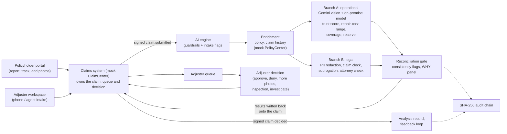

# Autonomous Parallel Multi-Agent FNOL Claims & Compliance Engine

> Autonomous analysis, human decision: specialist agents assess every claim in parallel; a licensed adjuster makes every call.

[](https://github.com/Vsd1208/Autonomous-Parallel-Multi-Agent-FNOL-Claims-Compliance-Engine/actions/workflows/ci.yml)
[](LICENSE)

**Problem.** When a loss is reported (First Notice of Loss, FNOL), an adjuster has to check coverage, judge the damage from
photos, set a reserve, meet state deadlines and look for fraud and recovery chances, mostly by hand and under time pressure.

**Solution.** Parallel specialist agents analyse each claim, a reconciliation gate cross-checks them and explains its recommendation, and
a person decides. **Guidewire is simulated here, modelled on public documentation and not verified against a tenant;** [how it maps](docs/guidewire-integration.md).



### What is real and what is simulated

| Component | Real or simulated | Why | Where in code |
|---|---|---|---|
| Damage assessment | **Real** Gemini 2.5 Flash API calls when a key is set; a deterministic mock for demos and tests | Demos and CI must run without a key | `GeminiVisionProvider.java`, `MockVisionProvider.java` (`fnol-agents`) |
| Replay mode (lite) | **Real recorded model output** for 66 CC0 photos; not live analysis, and a photo outside the set goes to a person | A review with no model or key still shows the checks working | `ReplayVisionProvider.java`, `demo-scenarios/replay/` |
| Second-opinion vision model | **Real**, trained in this project on 734 car photos (441 CC0 + 293 CC BY 4.0) and 307 public-domain FEMA property photos, every photo reviewed by eye (CLIP + DINOv2 encoders, chosen by benchmark); runs on-premise, so photos never leave | An independent check on a third-party model, and the reader of last resort when Gemini is down | `fnol-vision-ml/`, `tools/second-opinion/` |
| On-premise vision when Gemini is unavailable | **Real**: the second-opinion model reads vehicle photos in place of Gemini's placeholder and the claim is priced from the repair-cost range; flag `ON_PREMISE_VISION`, always an adjuster | Quotas and outages happen; the claim still gets a measured reading | `OnPremiseVision.java` |
| Repair-cost ranges | **Real published figures** (AAA, Consumer Reports, CCC, each linked); the band mapping is an assumption; accuracy on real claims unknown | Repair cost drives the reserve; no photo dataset has repair costs | `repair-cost-ranges.json`, `RepairCostEstimator.java`, `tools/cost-eval/` |
| Learning repair costs from real claims | **Real pipeline**: each decision stores the repair cost and its evidence (invoice, body-shop estimate, inspection; an adjuster's judgement is kept but never learned from; on a claim sent to investigation only the investigator's offline cost is learned); a learned table replaces the published one only when it is more accurate out of sample (50+ claims) | The way to a validated dollar estimate | `AiGovernanceService.java`, `tools/cost-eval/fit_costs.py` |
| Trust score (calibrated confidence) | **Real**, fitted and measured on 66 labelled Gemini answers | Gemini's own confidence does not separate right from wrong | `TrustScorer.java`, `tools/vision-eval/trust_score.py` |
| Face and licence-plate blurring | **Real** (OpenCV, YuNet) | Photos leave for an external model | `fnol-vision-ml/redaction/` |
| PII redaction in text | **Real**, rule-based | Personal data must not reach models or logs | `PiiRedactionAgent.java`, `PIIGuardrail.java` |
| State claim clock (CA, NY, TX, FL, IL) | **Real citations**; a prototype not reviewed by a lawyer; 3 recovery limits unverified | Deadlines are what regulators examine | `claim-regulations.json`, `CitedDeadlineRuleProvider.java`, [docs/legal-compliance.md](docs/legal-compliance.md) |
| Coverage rules, subrogation weights | **Simulated** (synthetic prototype values) | No insurer's real rules are available | `SyntheticCoverageRuleProvider.java`, `DeterministicSubrogationScorer.java` |
| Event-driven extension (signed events from a transactional outbox, retries, write-back, decisions first in the claims system) | **Real code, tested and run**, against the mock claims system | How an AI engine should sit on a core system | `ClaimEventController.java`, `ClaimDecisionRecorder.java`, `ClaimEventOutbox.java` |
| PolicyCenter and ClaimCenter | **Simulated**: a mock service over HTTP, modelled on public Guidewire documentation but not verified against a tenant | Students have no Guidewire Cloud tenant | `fnol-mock-guidewire/`, [docs/guidewire-integration.md](docs/guidewire-integration.md) |
| Policies, claimants, claim history | **Simulated** seed data | No real customer data | `fnol-mock-guidewire/` |
| Claim photos | **Real** public-domain photos (NHTSA crash tests, FEMA, CC0) | Realistic input without privacy issues | `demo-scenarios/sample-images/`, [CREDITS.md](CREDITS.md) |
| Fraud signals | **Real** rules (duplicates, reused photos, claim frequency, early-policy losses, amount above estimate) applied to simulated data | Common fraud patterns an adjuster checks | `IntakeReviewService.java`, `GateConsistencyChecker.java`, `EvidenceStore.java` |
| Fraud anomaly score | **Real** explainable scorer; **simulated** calibration (fitted on synthetic claims, accuracy on real claims unknown) | No labelled fraud data is public | `FraudAnomalyScorer.java`, `tools/fraud-eval/` |
| Adjuster authentication | **Real** sign-in with roles, using local accounts (no insurer identity provider) | Decisions are recorded under who made them | `AuthService.java`, `AdjusterTokenFilter.java` |
| Orchestration, persistence, audit chain | **Real** (Spring Boot, PostgreSQL, Flyway) | The production-shaped part of the system | `FNOLOrchestrator.java`, `AuditService.java` |

### Key results

All from small public datasets, not real claims. Runs, dates, samples and caveats: [docs/metrics.md](docs/metrics.md).

| Result | Value | Source |
|---|---|---|
| Wrong Gemini answers that could go straight through: confidence only → all vision checks | **11 → 1** of 66 in sample, about **11 → 3** out of sample | [metrics §3](docs/metrics.md#3-vision-checks-replayed-gate-ablation-vehicle) |
| Trust score: separating right from wrong, calibration error | AUC **0.79**, error **0.063** out of sample (range 0.030–0.153); Gemini's own 0.57, 0.090; 66 photos | [metrics §2](docs/metrics.md#2-trust-score-calibrated-ai-confidence-vehicle-claims) |
| Gemini damaged area right, lenient / strict | 82% / 58% (66 photos). **Dollar estimates not validated**: no true costs exist, so they are for reference | [metrics §1](docs/metrics.md#1-gemini-damage-assessment-vehicle), [§8](docs/metrics.md#8-repair-cost-estimates) |
| Severity gate: answers read as LOW / MEDIUM / HIGH, of 66 | 6 / 36 / 24 from the label and second opinion; 45 / 21 / 0 from the AI's dollars. No ground truth: routing, not accuracy | [metrics §3](docs/metrics.md#3-vision-checks-replayed-gate-ablation-vehicle) |
| Our on-premise model: damaged area right, strict / lenient | **78% / 87%** out of fold on 734 reviewed car photos; property cause of loss **93%** on 307 | [metrics §4](docs/metrics.md#4-second-opinion-model-trained-in-this-project) |
| Backend tests; demo scenario checks | 420 passing; 129 in lite mode | [metrics §6](docs/metrics.md#6-engineering) |

### Quick review (lite mode)

The fastest way to run it: no API key, no model downloads and no `vision-ml` service. Needs Docker and bash.

```bash
git clone https://github.com/Vsd1208/Autonomous-Parallel-Multi-Agent-FNOL-Claims-Compliance-Engine.git && cd Autonomous-Parallel-Multi-Agent-FNOL-Claims-Compliance-Engine
docker compose --env-file .env.lite -f docker-compose.yml -f docker-compose.lite.yml up -d --build
bash demo-scenarios/run-all.sh
```

Then open http://localhost:5173 and sign in as `ADJ-001`, password `demo-password`.

**Replay:** lite mode replays real recorded model answers for 66 photos, so the trust score, second opinion and vision checks work on real output: under New Claim, try the "Recorded" sample sets, including a confident wrong answer that the second opinion stops. It is **not live analysis of new photos**: any other photo gets a placeholder and goes to a person, and no photo can reach an external model, because the engine refuses to start in lite mode with Gemini on.

**Measured:** 129 checks passed, 0 failed. Build time is re-measured at the end of this work. See [metrics §6](docs/metrics.md#6-engineering).

### Where to look next

- [docs/DOMAIN.md](docs/DOMAIN.md): the insurance terms, and how a claim moves
- [docs/REVIEW_QA.md](docs/REVIEW_QA.md): the hard questions, answered honestly
- [docs/guidewire-integration.md](docs/guidewire-integration.md): how it maps to Guidewire Cloud, and where a real tenant would differ
- [docs/metrics.md](docs/metrics.md): every number, with its run and caveat
- [docs/MODULE_GUIDE.md](docs/MODULE_GUIDE.md): the code, area by area

---

## Reference

Everything below is reference material.

### The problem and the engine in full

**Problem.** When a policyholder reports a loss (First Notice of Loss, FNOL), an adjuster has to check coverage, judge
the damage from photos, set a reserve, meet state claim-handling deadlines and look for fraud and recovery chances,
mostly by hand and under time pressure.

**Solution.** This engine takes the FNOL, then runs an operational branch (photo damage assessment with Google Gemini,
checked by an on-premise vision model trained here that also takes over when Gemini is unavailable; a sourced
repair-cost range; coverage; reserve) and a legal branch (PII redaction, a cited state claim clock,
subrogation) in parallel under one deadline. A reconciliation gate cross-checks the two and explains its recommendation
in a six-factor WHY panel. A licensed adjuster makes every decision, and every step is written to a tamper-evident audit
chain.

### How it fits with the claims system

**It works as an extension of the claims system, not beside it.** ClaimCenter (mocked here) owns the claim, the work
queue and the decision. A signed event wakes the engine, which writes its results back onto that claim; a decision made
anywhere reaches its feedback loop. How this maps to App Events, Integration Gateway and the Cloud API, and where a real
tenant would differ: [docs/guidewire-integration.md](docs/guidewire-integration.md) (modelled from public documentation,
not verified against a tenant).


### More results

All from small public datasets, with runs and caveats in [docs/metrics.md](docs/metrics.md).

| Result | Value | Source |
|---|---|---|
| Wrong answers passing every other check that the second opinion caught | 2 of 2 (66 answers) | [metrics §4](docs/metrics.md#4-second-opinion-model-trained-in-this-project) |
| On-premise model, compared with CLIP alone; property type | 78% / 87% against 65% / 81%; property type 90% on 307 reviewed FEMA photos | [metrics §4](docs/metrics.md#4-second-opinion-model-trained-in-this-project) |

### Lite mode in detail

**Measured on 3 Nov 2026, one laptop:** 116 s from build to healthy (78 s for `build --no-cache`, 38 s to start). The base images were already on this machine and the connection was about 5 MB/s, so a first run also has to pull those images (Maven alone is 775 MB). On a very slow connection it takes far longer: at under 76 KB/s the same build had not finished after 39 minutes.

**What is off in lite mode:**

- Vision is mock: canned answers, no real photo analysis. To keep it that way, the engine refuses to start in lite mode with Gemini enabled, because photo blurring lives in `vision-ml`. No photo can reach an external model unblurred.
- The second opinion is the recorded one, for the recorded photos only, and health and each claim's notes say so. For any other photo there is none, so `MODEL_DISAGREEMENT` cannot fire on it, and the fraud score has no disagreement input.
- There is no on-premise vision reading, and no photo blurring.

**No scenario expectation differs for lite mode:** the ten scenarios send `mock://` evidence, which keeps its canned answer in both modes. The five recorded-photo scenarios run only in lite mode, and they exercise the vision checks on recorded answers; a claim in them can also raise `PHOTO_REUSED` on a repeat run, so they check the vision flags and not the final route.

### Quick start, full mode (no API key needed)

Adds the `vision-ml` service: the second-opinion model and photo blurring. Needs Docker and bash. The first build downloads PyTorch and the second-opinion model's two image encoders (CLIP and DINOv2 weights, about 0.9 GB); the built `vision-ml` image is 5.4 GB.

```bash
git clone https://github.com/Vsd1208/Autonomous-Parallel-Multi-Agent-FNOL-Claims-Compliance-Engine.git && cd Autonomous-Parallel-Multi-Agent-FNOL-Claims-Compliance-Engine
docker compose --env-file .env.demo up -d --build
bash demo-scenarios/run-all.sh
```

Then open the adjuster workspace at http://localhost:5173 and the policyholder portal at http://localhost:5174. With `.env.demo`, sign in to the workspace as `ADJ-001` (adjuster), `SEN-001` (senior adjuster), `SUP-001` (supervisor) or `INS-101` (inspector), password `demo-password`. Without it, Compose's local-only password is `local-dev-password`.
More: [running locally](#running-locally), [the insurance terms explained](docs/DOMAIN.md), [roadmap and known
limits](docs/ROADMAP.md).


## What we mean by "autonomous" and "agent"

**Autonomous** means the analysis pipeline runs end to end with no one driving it. It never means autonomous decisions:
a licensed adjuster makes every call, the AI never pays, and with the default settings every claim gets a human decision.
The one exception is an explicit business setting, off by default ([ADR-009](docs/architecture-decisions.md)), which an
insurer could turn on to let eligible claims skip the adjuster's confirmation.

**Agent** means a specialist component with one job, typed inputs and outputs, and its own audit record. It does not mean
an LLM agent choosing its own actions: the pipeline's order is fixed in code. (In insurance an "agent" is also a person who
sells or services policies; we say "insurance agent" for that.)

| Uses machine learning | Deliberately rule-based, because the decision must be explainable and auditable |
|---|---|
| Gemini vision (`GeminiVisionProvider`) | Coverage (`PolicyValidatorAgent`) |
| On-premise vision model, also the second opinion (`SecondOpinionAgent`, `OnPremiseVision`) | Claim clock (`StatutoryDeadlineAgent`) |
| Trust score (`TrustScorer`) | PII redaction (`PiiRedactionAgent`) |
| Fraud anomaly score (`FraudAnomalyScorer`; fitted statistics on synthetic claims, accuracy on real claims unknown) | Reserve (`ReserveCalculatorAgent`) |
| | Subrogation (`SubrogationScorerAgent`) |

## Governance statement

**By default every claim gets a human decision.** With `fnol.stp.require-advisory-review=true` (env `FNOL_STP_REQUIRE_ADVISORY_REVIEW`, the default) a claim that meets every straight-through-processing (STP) rule waits as `PENDING_ADVISORY_REVIEW`, with no reserve posted, until an adjuster confirms it. Setting the flag to `false` lets STP-eligible claims be filed as `STRAIGHT_THROUGH_PROCESSING` with no human step — a business decision (see [ADR-009](docs/architecture-decisions.md)).

- AI analyzes, recommends and explains; it never pays.
- Any failed factor, HIGH severity or intake flag routes the claim to `HUMAN_REVIEW`.
- No claim is dropped. A filed claim whose analysis fails stays in review with a high-priority activity for an adjuster; a failed direct intake is saved as a `REJ-…` claim and queued for a human. Duplicate reports are refused and flag the original claim for verification.
- A decision is recorded in the claims system first; if it cannot be reached, nothing is recorded anywhere and the adjuster is told.
- **Only a person posts a reserve.** A filed claim is open, as on ClaimCenter, but the AI's figure is only a recommendation, in an activity and a note. An adjuster's approval is what puts a reserve on the exposure ([ADR-013](docs/architecture-decisions.md)).
- Every agent step, failure and adjuster decision is recorded in a SHA-256 hash-chained audit trail. Raw PII is never stored or hashed.
- Coverage rules and subrogation weights are **synthetic prototype values**. The state claim clock cites real regulations ([docs/legal-compliance.md](docs/legal-compliance.md)) but has not been reviewed by a lawyer; Compliance must confirm all rules before production use.

## End-to-end flow

```text
0. Policyholder portal       report a loss (WEB), track it, add requested photos (separate app, no adjuster access)
1. Report to claims system   claim number issued, duplicate check, then a signed claim.submitted event to the engine
2. Input validation (HRP1)   format guardrail + intake review flags
3. Context enrichment        policy, claim history, frequency risk
4. Dual-branch analysis      Branch A: damage, coverage, reserve + confidence | Branch B: PII, deadlines, liability
5. Reconciliation gate       subrogation, guardrails, consistency checks, WHY panel, results written onto the claim, audit
6. Routing                   PENDING_ADVISORY_REVIEW | STRAIGHT_THROUGH_PROCESSING | HUMAN_REVIEW
7. Human review (HRP2/HRP3)  queue from the claims system, modify findings, decision recorded there first
8. Feedback                  claim.decided event: analysis record, audit chain and feedback loop follow, for a decision made anywhere
```

See [docs/architecture.md](docs/architecture.md) for the full diagram, and [docs/diagram-traceability.md](docs/diagram-traceability.md) for how each of the 23 diagram components maps to code, endpoints and tests.

## Implementation status

| Area | Status |
|---|---|
| FNOL intake API with channel, optional claimant phone/email | Done |
| Input guardrail + intake review flags (Human Review Point 1) | Done |
| Claim-history enrichment (frequency risk) | Done |
| Parallel branches on a bounded executor, one deadline, interrupting cancel | Done |
| Vision: Gemini provider with SSRF-safe evidence loading; deterministic mock provider | Done |
| Coverage by line of business (AUTO, HOME) | Done (synthetic rules) |
| Recommended reserve (amount owed): from a sourced table by line, coverage and severity, the AI's figure moving it only within a bound; the lower of that and the amount claimed, less the deductible, capped at the limit ([ADR-015](docs/architecture-decisions.md)) | Done |
| Claims above what the reserve supports never auto-approved: adjuster can request more photos, assign an inspector, investigate or approve at the recommended reserve | Done |
| Standard photo set: front, rear, left, right and a damage close-up (home: overview and close-up), all sent to the AI together; an incomplete set is flagged `INCOMPLETE_PHOTO_SET` | Done |
| Adjuster sets the final reserve (pre-filled with the AI or inspected recommendation; a different amount needs a reason) | Done |
| Supplementary photos: adjuster sends a one-time, 7-day upload link; the claimant adds the requested views to the same claim, which returns to the adjuster | Done |
| Damage inspection: adjuster assigns an inspector (field, desk or body shop); the report gives the accident-related cost, earlier damage excluded | Done |
| PII redaction (SSN, DOB, MRN, name, phone, email) + PII guardrail | Done |
| State claim clock: acknowledge-by and decide-by from cited regulations (CA, NY, TX, FL, IL), urgency flag, acknowledgement letter | Done (prototype, not legally reviewed) |
| Subrogation: Branch B liability assessment with compliance notes, finalised with Branch A's severity | Done |
| Gate consistency checks (AI dollars vs the published range for the severity, reserve vs limit, damage vs line, confidence vs photo) | Done |
| Six-factor WHY panel, configurable STP thresholds (`fnol.stp.*`) | Done |
| Advisory review before STP counts as filed (Human Review Point 2) | Done, on by default |
| Adjuster review with state checks, token, audit event, modify reserve, require investigation (Human Review Point 3) | Done |
| Failed intakes persisted and escalated (`REJ-…`); duplicates flagged for verification | Done |
| Fraud anomaly score over six intake features with its top contributors; `FRAUD_ANOMALY` routes to an adjuster and suggests an SIU referral, never denies | Done (calibrated on synthetic data) |
| On-premise vision model (`fnol-vision-ml`): damaged car area, visible damage extent, property cause of loss and property type; checks Gemini (`MODEL_DISAGREEMENT`) and reads vehicle photos itself when Gemini is unavailable (`ON_PREMISE_VISION`, always an adjuster) | Done |
| Repair-cost range per damaged area and extent from published AAA / Consumer Reports / CCC figures, with sources shown to the adjuster; prices on-premise readings; `ESTIMATE_OUTSIDE_PUBLISHED_RANGE` when Gemini's estimate is more than 2x outside | Done (published figures; accuracy on real claims unknown) |
| Repair-cost learning: each decision stores the repair cost and its evidence (invoice, body-shop estimate, inspection, investigation); judgements and figures entered during an investigation are never learned from; a learned table ships only when it beats the published one out of sample on 50+ claims | Done (no real costs collected yet) |
| Hash-chained audit trail + `chainValid` + PDF report | Done |
| Claim lifecycle draft → open → closed; reserve posted by the adjuster's decision; attachments, tracked review actions; sync status with a manual retry endpoint | Done (no scheduled retry job) |
| Adjuster queue (API + console page) | Done |
| Console wired to live data; internal intake (phone, agent) with channel selector and photo upload | Done |
| Policyholder claims portal (separate app on 5174): report a loss, track it with claim + policy number, add requested photos; never sees AI findings, reserve or notes | Done |
| Reproducible demo (`.env.demo`, `run-all.sh`, 10 scenarios, 5 recorded-answer scenarios in lite mode) | Done |
| Authentication | Sign-in with adjuster, senior adjuster, supervisor and inspector roles (local accounts; no insurer identity provider or SIU role yet) |

## Repository structure

```text
fnol-common/          Shared records (Models.java) and exceptions
fnol-mock-guidewire/  Mock PolicyCenter + ClaimCenter on port 9090
fnol-enrichment/      PolicyCenter/ClaimCenter clients, ClaimHistoryEnricher
fnol-agents/          Agents, vision providers, EvidenceImageLoader, rule providers
fnol-guardrails/      Input, output, PII and coverage guardrails
fnol-orchestrator/    FNOLOrchestrator, IntakeReviewService, ExplanationBuilder, STP settings
fnol-api/             REST API, security filters, audit chain, evidence store, persistence, Flyway V1–V22, PDF
fnol-vision-ml/       On-premise vision service (Python): second opinion, property heads, face and plate blurring
frontend/             React + Vite adjuster workspace (src/) and policyholder portal (portal/)
tools/                vision-eval (Gemini evaluation, trust score, photo collection and review), second-opinion
                      (training the on-premise model), cost-eval (repair costs), fraud-eval (fraud score)
demo-scenarios/       Ten scenario payloads, run-all.sh, duplicate script, sample photos, replay set
postman/              Request collection
docs/                 Architecture, ADRs, agents, API, database, Guidewire, traceability
```

## Routing rules

Severity from the vision label, not the AI's dollars ([ADR-016](docs/architecture-decisions.md)): MINOR is **LOW**, MODERATE is **MEDIUM**, SEVERE is **HIGH**. If the second opinion's visible extent differs or there is no label, the more severe reading stands. A table-based reserve above $20,000 is HIGH.

| Factor | Passes when |
|---|---|
| AI Confidence | Vision confidence ≥ 0.85 |
| Coverage Status | Policy active and in term, with a coverage the line-of-business rule accepts |
| Compliance (PII) | No PII detected, or PII redacted with confidence ≥ 0.90 |
| Reserve Amount | Recommended reserve ≤ $25,000 |
| Claim History | Claim frequency risk LOW or MEDIUM |
| Subrogation Risk | Score < 70 |

A claim is STP-eligible when severity is LOW or MEDIUM, all six factors pass, no intake flag is raised (`MISSING_EVIDENCE`, `INCOMPLETE_PHOTO_SET`, `PHOTO_REUSED`, `ATTORNEY_REPRESENTED`, `CLAIMANT_NAME_MISMATCH`, `INCIDENT_OUTSIDE_POLICY_PERIOD`, `INCIDENT_NEAR_POLICY_START`, `HIGH_CLAIM_FREQUENCY`) and no gate consistency flag is raised (`SEVERITY_ESTIMATE_MISMATCH`, `RESERVE_EXCEEDS_COVERAGE_LIMIT`, `DAMAGE_TYPE_LINE_MISMATCH`, `PHOTO_SUBJECT_MISMATCH`, `MODEL_DISAGREEMENT`, `ON_PREMISE_VISION`, `ESTIMATE_OUTSIDE_PUBLISHED_RANGE`, `POSSIBLE_FLOOD_EXCLUSION`, `CONFIDENCE_PHOTO_QUALITY_MISMATCH`, `AMBIGUOUS_DAMAGE_TYPE`, `CLAIMED_EXCEEDS_AI_ESTIMATE`, raised when the amount claimed is more than 10% above what the reserve supports, `fnol.stp.claimed-amount-tolerance`; and `FRAUD_ANOMALY`, raised when the fraud anomaly score reaches its threshold, `fnol.stp.fraud-anomaly-threshold`). HIGH severity always goes to a human. All thresholds are properties under `fnol.stp`.

## API

Full contracts: [docs/api-contracts.md](docs/api-contracts.md). 🔒 = requires a signed-in person (`Authorization: Bearer`) or the service credential (`X-Adjuster-Token`).

| Method | Endpoint | Purpose |
|---|---|---|
| POST | `/api/v1/auth/login` | Sign in; roles decide the rest. Also `/logout`, `/me` |
| GET | `/api/v1/health` | Health check; `intake` says whether losses go to the claims system (`CLAIMS_SYSTEM`) or the direct path (`DIRECT`) |
| POST 🔒 | `/api/v1/fnol/report` | Staff phone intake and partner channels: file the loss in the claims system; answers at once with the claim number |
| POST | `/api/v1/events/claimcenter` | Signed claims-system events (`claim.submitted`, `claim.decided`); HMAC signature, no adjuster token |
| POST | `/api/v1/portal/claims` | Policyholder reports a loss (channel WEB); returns a receipt without AI findings or reserve |
| GET | `/api/v1/portal/claims/{claimId}?policyNumber=` | Policyholder tracks a claim: plain-language stage, dates, requested photos, acknowledgement letter |
| POST 🔒 | `/api/v1/fnol/intake` | Direct intake (partner channels): analyse, then create the claim, and receive the full analysis |
| GET 🔒 | `/api/v1/fnol/status/{claimId}` | Saved claim row (status, decision, flags, failure reason, sync status) |
| GET 🔒 | `/api/v1/fnol/{claimId}/explanation` | Saved WHY panel |
| GET 🔒 | `/api/v1/fnol/{claimId}/analysis` | Full AI analysis saved at intake (no description text) |
| GET 🔒 | `/api/v1/fnol/{claimId}/claimcenter` | The claim as ClaimCenter holds it: exposures with reserves, activities, notes, documents |
| GET 🔒 | `/api/v1/fnol/{claimId}/documents` | Evidence on the claim (photos and references) |
| GET 🔒 | `/api/v1/fnol/{claimId}/documents/{documentId}/content` | The stored photo |
| POST 🔒 | `/api/v1/fnol/{claimId}/claimcenter-sync` | Retry a FAILED ClaimCenter decision sync |
| POST/GET 🔒 | `/api/v1/fnol/{claimId}/upload-requests` | Ask the claimant for more photos (one-time link, claim → `NEEDS_MORE_INFO`) / list requests |
| GET / POST | `/api/v1/public/upload/{token}` | Claimant upload page data / add photos (link token, no adjuster token) |
| GET 🔒 | `/api/v1/inspectors` | Inspector roster |
| GET/POST 🔒 | `/api/v1/fnol/{claimId}/inspections` | List / assign an inspection (claim → `INSPECTION_ASSIGNED`) |
| POST 🔒 | `/api/v1/fnol/{claimId}/inspections/{id}/report` | Inspector's report (claim → `HUMAN_REVIEW`) |
| POST 🔒 | `/api/v1/fnol/{claimId}/inspections/{id}/cancel` | Withdraw an open assignment |
| GET 🔒 | `/api/v1/fnol/{claimId}/audit` | Audit events in chain order + `chainValid` |
| GET 🔒 | `/api/v1/fnol/{claimId}/audit/pdf` | PDF audit report |
| GET, POST 🔒 | `/api/v1/fnol/{claimId}/reserve-approvals`, `/{id}/decide` | A reserve above someone's authority waits here; another person with enough authority approves or declines it |
| POST 🔒 | `/api/v1/fnol/{claimId}/review` | Record an adjuster decision (approve, reject, more info, investigation, close), optionally adjusting the reserve and recording the final repair cost and its evidence (`finalRepairCost`, `repairCostSource`) |
| GET 🔒 | `/api/v1/fnol/queue?status=HUMAN_REVIEW&page=0&size=20` | Adjuster queue from the claims system, oldest first; `source` says if it fell back to the engine's records |
| GET 🔒 | `/api/v1/ai/metrics` | AI governance: routing, flags, leakage, adjuster agreement, repair-cost accuracy, privacy, drift, fairness |
| GET 🔒 | `/api/v1/ai/feedback` | Each adjuster decision next to the AI's view |

Errors: 400 `VALIDATION_ERROR`, 401 `UNAUTHORIZED`, 409 `DUPLICATE_FNOL` / `CLAIM_ID_CONFLICT` / `INVALID_STATE`, 422 `COMPLIANCE_BLOCK`, 502 `EXTERNAL_OR_PROCESSING_ERROR`, 504 `PROCESSING_TIMEOUT`. Failed intakes return the saved `REJ-…` ID in `claimId`.

## Running locally

Prerequisites: Java 17+, Maven 3.9+, Node 18+, Docker.

### Demo stack (no API key needed)

```bash
docker compose --env-file .env.demo up -d --build
bash demo-scenarios/run-all.sh        # posts all 10 scenarios, exits non-zero on any mismatch
```

If port 5432 is already in use on your machine, add `POSTGRES_HOST_PORT=5433` in front of the compose command.

| Service | URL |
|---|---|
| Adjuster workspace | http://localhost:5173 (queue at `/queue`) |
| Policyholder portal | http://localhost:5174 (report, track, upload links) |
| API health | http://localhost:8080/api/v1/health |
| Mock PolicyCenter | http://localhost:9090/pc/policies/POL-AUTO-112233 |

`.env.demo` sets `GEMINI_VISION_ENABLED=false` (deterministic `MockVisionProvider`) and the demo adjuster token `demo-adjuster-token`, which the console build also uses. Stop with `docker compose down` (add `-v` to wipe the database).

### With real Gemini vision

Copy `.env.example` to `.env`, set `GEMINI_API_KEY`, `FNOL_ADJUSTER_TOKEN` and, if photos come from URLs, `FNOL_EVIDENCE_ALLOWED_HOSTS`, then `docker compose up -d --build`. If Gemini cannot answer (no key, quota, outage), vehicle photos are read by the on-premise model and priced from the repair-cost range (`ON_PREMISE_VISION`); other claims get a 0.60-confidence placeholder. Either way the claim goes to a human.

### Tests and builds

```bash
mvn -B clean verify                           # backend tests, as CI runs them (clean: no stale build output)
cd frontend && npm install && npm run build    # adjuster workspace
npm run build:portal                           # policyholder portal (dist-portal/, no adjuster token)
```

## Demo scenarios

Run with mock vision (`.env.demo`). `run-all.sh` runs every scenario twice and checks the same outcomes: by **direct intake** (expected results below) and **through the claims system** (filed there, analysed from its event, results checked on both sides). A failure is then not an HTTP error: scenario 3 ends as `BLOCKED_COMPLIANCE` and scenario 4 as `HUMAN_REVIEW`, each a filed claim waiting for a person. It finishes with decisions: through the workspace, refused on a finished claim, and made directly in the claims system with the engine following. `INTAKE=direct` or `INTAKE=claims-system` runs one pass.

It substitutes a fresh incident date per run, 1–28 days ago unless a scenario sets its own range. A full run uses up about 12 of those dates on one policy, so after two or three runs the duplicate check refuses further reports and the script says so; `docker compose down -v` resets the demo database.

| # | File | Expected |
|---|---|---|
| 1 | `scenario_1_clean_stp.json` | 200, `PENDING_ADVISORY_REVIEW`, decision `STRAIGHT_THROUGH` (subrogation 30) |
| 2 | `scenario_2_low_confidence.json` | 200, `HUMAN_REVIEW` (blurry photo, confidence 0.61) |
| 3 | `scenario_3_compliance_block.json` | 422 `COMPLIANCE_BLOCK` (MRN); saved as `REJ-…` `BLOCKED_COMPLIANCE` |
| 4 | `scenario_4_api_timeout.json` | 504 `PROCESSING_TIMEOUT` (slow photo exceeds the 10 s deadline); saved as `REJ-…` `HUMAN_REVIEW` |
| 5 | `scenario_5_duplicate.json` / `.sh` | 200, then 409 `DUPLICATE_FNOL` |
| 6 | `scenario_6_high_claim_frequency.json` | 200, `HUMAN_REVIEW`, flag `HIGH_CLAIM_FREQUENCY` |
| 7 | `scenario_7_home_policy.json` | 200, `PENDING_ADVISORY_REVIEW` (home policy covered by DWELLING) |
| 8 | `scenario_8_claim_above_estimate.json` | 200, `HUMAN_REVIEW` ($9,000 claimed, above the AI estimate: `CLAIMED_EXCEEDS_AI_ESTIMATE`) |
| 9 | `scenario_9_home_flood.json` | 200, `HUMAN_REVIEW`, flag `POSSIBLE_FLOOD_EXCLUSION` (flood is excluded from homeowners policies) |
| 10 | `scenario_10_fraud_anomaly.json` | 200, `HUMAN_REVIEW`, flag `FRAUD_ANOMALY` (reported 75–90 days late, early in the policy, 9.5% above the estimate: no single rule fires, the combination does) |

Real photo sets for the claim form (**Load real photo set**): six crashed vehicles (NHTSA) and five damaged homes, one per
cause of loss (burst pipe, trees on the roof, hurricane roof, wildfire, river flood; FEMA and CC0 photos). Credits and
licences: [demo-scenarios/sample-images/CREDITS.md](demo-scenarios/sample-images/CREDITS.md).

## Configuration

| Variable | Default | Purpose |
|---|---|---|
| `SERVER_PORT` | `8080` | API port |
| `MOCK_GUIDEWIRE_BASE_URL` | `http://localhost:9090` | Mock Guidewire address |
| `SPRING_DATASOURCE_URL`, `_USERNAME`, `_PASSWORD` | local `fnol` database | PostgreSQL |
| `FNOL_ORCHESTRATOR_TIMEOUT_SECONDS` | `10` | Deadline for both branches |
| `FNOL_ORCHESTRATOR_POOL_SIZE` / `_QUEUE_SIZE` | `8` / `32` | Branch executor bounds (2 tasks per intake) |
| `FNOL_STP_REQUIRE_ADVISORY_REVIEW` | `true` | STP-eligible claims wait for an adjuster |
| `FNOL_STP_FRAUD_ANOMALY_ENABLED` | `true` | Fraud anomaly score on or off |
| `FNOL_STP_FRAUD_ANOMALY_THRESHOLD` | empty (the fitted 6.74) | Score at which `FRAUD_ANOMALY` is raised |
| `FNOL_RESERVE_METHOD` | `AVERAGE_TABLE` | Initial reserve from the sourced table, or `AI_ESTIMATE` for the old formula ([ADR-015](docs/architecture-decisions.md)) |
| `FNOL_RESERVE_AI_ADJUSTMENT_MAX` | `0.40` | How far the AI may move the table's base, when its reading holds up |
| `FNOL_AUTHORITY_ADJUSTER` / `FNOL_AUTHORITY_SENIOR_ADJUSTER` | `10000` / `50000` | Reserve each role may post: synthetic prototype values. A supervisor has no limit |
| `FNOL_LITE_MODE` | `false` | Quick review without `vision-ml`; refuses to start with Gemini on. Set by `docker-compose.lite.yml` |
| `FNOL_SECOND_OPINION_URL` | `http://vision-ml:8090` in Compose | On-premise vision service; empty turns the second opinion and on-premise vision off |
| `FNOL_REDACTION_URL` / `FNOL_REDACTION_REQUIRED` | `http://vision-ml:8090` / `true` | Face and plate blurring before photos leave; when required and unavailable, no photo is sent |
| `VISION_ML_THREADS` | `2` | CPU threads of the vision service |
| `FNOL_USERS` | local-only accounts in Compose | People's sign-ins: `id\|ROLE\|password\|Display Name;...`. Set your own beyond a laptop demo |
| `FNOL_ADJUSTER_TOKEN` | empty (service requests rejected) | Service credential for integrations and scripts; in no browser bundle |
| `FNOL_CORS_ALLOWED_ORIGINS` | `http://localhost:5173,http://localhost:5174` | Allowed browser origins (workspace and portal) |
| `FNOL_PORTAL_BASE_URL` | `http://localhost:5174` | Portal address used in one-time upload links |
| `FNOL_EVIDENCE_ALLOWED_HOSTS` | empty | https hosts evidence photos may be downloaded from |
| `GEMINI_API_KEY` | empty | Gemini key (sent as `x-goog-api-key` header) |
| `GEMINI_VISION_ENABLED` | `true` | `false` = deterministic mock vision |
| `GEMINI_VISION_MODEL` | `gemini-2.5-flash` | Model name |
| `GEMINI_VISION_READ_TIMEOUT_SECONDS` | `8` | Gemini read timeout (below the orchestrator deadline) |
| `GEMINI_VISION_THINKING_BUDGET` | `0` | Gemini 2.5 thinking tokens; 0 keeps calls fast |
| `GEMINI_VISION_CALIBRATION_ENABLED` | `true` | Apply the trained confidence calibration when one matches the model |
| `GUIDEWIRE_AUTH_BEARER_TOKEN` | empty | Bearer token sent on PolicyCenter / ClaimCenter calls (the mock needs none) |
| `MOCK_GW_TIMEOUT` | `false` | Mock ClaimCenter create waits 11 s |
| `MOCK_PC_TIMEOUT` | `false` | Mock PolicyCenter coverages wait 12 s |
| `CLAIMS_EVENT_SECRET` | local-only default in Compose | Signs claims-system events; set the same value on both services. Empty: the engine refuses events and uses direct intake |
| `CLAIMS_EVENT_SUBSCRIBERS` | the API, in Compose | Where the claims system delivers its events |
| `MOCK_CC_START_SEQUENCE` | `1` | Lowest first mock ClaimCenter claim number; numbering otherwise continues after the highest stored claim |
| `MOCK_CC_DB_URL` | in-memory H2 | Mock ClaimCenter database; Compose uses Postgres (schema `claimcenter`), so its claims survive restarts |
| `API_HOST_PORT` | `8080` | Host port for the API (use e.g. `8081` if another server already uses 8080) |
| `POSTGRES_HOST_PORT` | `5432` | Host port for the compose Postgres |
| `VITE_API_BASE_URL` | `http://localhost:8080` | API address for the console |

## Vision evaluation

**How each claim was decided.** Every claim's Summary shows three parts side by side: what machine learning
estimated (Gemini, the second-opinion model, and what was blurred or withheld before photos left), what the rules
decided from it with the claim's own numbers (coverage, the reserve formula, statutory deadlines, the route and its
flags), and what the licensed adjuster decided (who, when, final reserve and reason). ML never pays, denies or closes a
claim. The notes also give each branch's time: the legal branch runs in parallel with the operational one, so it adds
no waiting (in one observed claim with Gemini: operational 3.9 s, legal about 1 ms; not a benchmark, see the Gemini latency in [docs/metrics.md](docs/metrics.md)).

**Legal and compliance checks** (rule-based, in parallel with the damage assessment): a regulatory claim clock from a cited, versioned rule set (acknowledge from notice, decide from a complete proof of loss, business days where the rule says), a written acknowledgement letter filed on the ClaimCenter claim, subrogation with the other party's details and a recovery-deadline activity, attorney-representation routing, and unfair-discrimination testing on the AI Governance page. Rules, sources and how well each was verified: [docs/legal-compliance.md](docs/legal-compliance.md). Not legal advice.

**AI governance.** Model cards for every AI component, with measured results and limits: [docs/model-cards.md](docs/model-cards.md). The console's **AI Governance** page (`GET /api/v1/ai/metrics`) shows routing, flags, leakage kept from over-payment, adjuster agreement (each decision is recorded next to the AI's view, `GET /api/v1/ai/feedback`), what left the system for the external model, and weekly drift. Before any photo goes to Gemini, faces and licence plates are blurred by `fnol-vision-ml` and the odometer / VIN photo is withheld; if blurring is unavailable no photo is sent (`fnol.redaction.required`).

`tools/second-opinion/` trains the second-opinion vision model (CLIP + DINOv2 embeddings, chosen by `benchmark_encoders.py` over four encoders, + logistic regression on 734 reviewed car photos; a visible-extent head; trained heads for property cause of loss and property type on 307 reviewed FEMA photos, `property_heads.py`; a zero-shot head for the photo subject) served by `fnol-vision-ml`; when it disagrees with Gemini the claim goes to an adjuster (`MODEL_DISAGREEMENT`), and when Gemini is unavailable it reads vehicle photos itself (`ON_PREMISE_VISION`). See [tools/second-opinion/README.md](tools/second-opinion/README.md).

`tools/vision-eval/` measures Gemini's damage-zone accuracy on a public-domain (CC0) labelled car-damage dataset and fits the trust score; it also collects the extra training photos and records the by-eye review of every one (`make_contact_sheets.py`, `review_decide.py`, `*_review.json`). See [tools/vision-eval/README.md](tools/vision-eval/README.md).

`tools/cost-eval/` checks Gemini's dollar estimates against the published repair-cost ranges and learns repair costs from adjusters' evidence-backed figures. See [tools/cost-eval/README.md](tools/cost-eval/README.md).

## Known limits

What comes next and why: [docs/ROADMAP.md](docs/ROADMAP.md).

- Guidewire is mocked, and the extension design is modelled from public documentation, not verified against a tenant. Reserve authority limits are modelled on ClaimCenter's concept, with synthetic amounts. All of it: [docs/guidewire-integration.md](docs/guidewire-integration.md).
- If the claims system is down during a photo request or inspection step, its work queue for that claim stays out of date (the claim file shows the right status). Decisions are not affected: they stop, with a clear error.
- Sign-in uses local accounts, not an insurer's identity provider, and there is no SIU role ([ADR-014](docs/architecture-decisions.md)).
- **No real adjuster has used this, and nothing here has run on a real Guidewire tenant.** The product measures handling time and usefulness, but the [results are empty](docs/adjuster-study.md), so no time saving is claimed. The [sandbox request and first-day steps](docs/guidewire-sandbox-request.md) are ready.
- Claims with `cc_sync_status=FAILED` (direct intake, photo and inspection steps) are marked for retry, but no retry job exists yet.
- Photos are uploaded in the console as inline data URIs (≤ 5 MB) or referenced by allow-listed URL; there is no separate document store.
- The branches use `FutureTask`s on a bounded executor rather than `CompletableFuture` (so a stuck branch can be interrupted), and the console is React rather than Guidewire Jutro — see ADR-011.
- The idempotency guard's in-memory layer is per JVM; run one API instance or move it to the database.
- Vision data limits: no public photos of burst-pipe water damage exist, so that cause cannot be learned; commercial property (35 photos) has no fire or fallen-tree examples; the 293 CC BY 4.0 car photos carry their uploaders' licence, which cannot be traced further. Details: [docs/model-cards.md](docs/model-cards.md).
- No dollar estimate is validated yet, Gemini's included: the published repair-cost ranges are figures from AAA, Consumer Reports and CCC mapped to damage extent by assumption, until real invoices and inspections accumulate.
